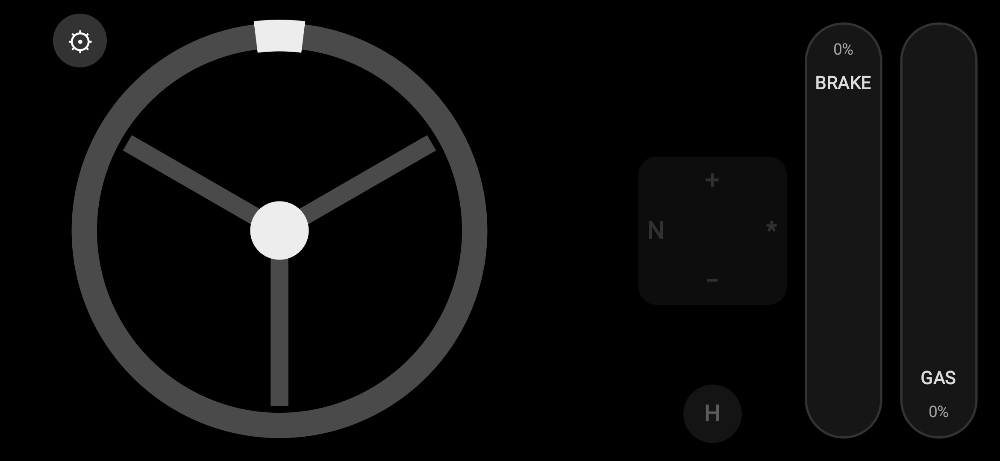
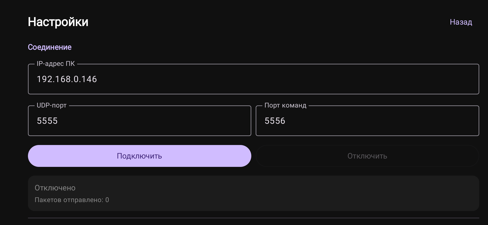

# MyJoystick

Turns an Android phone into a wireless game controller: steering wheel, pedals, gear shifting and handbrake.
The phone streams axis state over UDP to a PC at 100 Hz, where it is received by a
[daemon](https://github.com/tynkovski/androidjoystick-daemon) that creates a virtual gamepad through `/dev/uinput`.
To BeamNG.drive on Linux it looks like an ordinary controller — no Bluetooth, drivers or kernel modules.

| Control screen | Settings |
|---|---|
|  |  |

## How it works

```
Android (MyJoystick)  ──UDP 5555, 24 bytes, 100 Hz──▶  PC daemon  ──uinput──▶  BeamNG / SDL
                      ──UDP 5556, 1 byte (commands)──▶
```

Sending happens from a foreground service, so the stream is not interrupted when the screen is off.
If the PC stops receiving packets, the daemon zeroes all axes after 0.3 s.

### Protocol

**Control stream — UDP `5555`, 24 bytes, little-endian, 100 Hz**

| Offset | Size | Type | Field | Range |
|---:|---:|---|---|---|
| 0 | 4 | magic | `"WHL2"` | — |
| 4 | 4 | `int32` | `seq` (packet counter) | — |
| 8 | 4 | `float32` | steering | `−1.0 … +1.0` |
| 12 | 4 | `float32` | throttle | `0.0 … 1.0` |
| 16 | 4 | `float32` | brake | `0.0 … 1.0` |
| 20 | 4 | `float32` | clutch (reserved) | `0.0 … 1.0` |

**Commands — UDP `5556`, 1 byte**

| Byte | Action |
|---|---|
| `u` | shift up |
| `d` | shift down |
| `n` | neutral |
| `h` | handbrake |

## Control screen

- **Steering wheel** — rotates with a finger along the rim, limited by the "lock to lock" setting.
- **Pedals** — vertical `BRAKE` and `GAS` strips; pressure depends on the touch point, with smooth press and release ramps.
- **Gear pad** — swipe up (`+`) and down (`−`), left (`N`) for neutral, right (`*`) reserved.
- **`H`** — handbrake.
- **⚙** — opens settings.

Command buttons are disabled until a connection is established.

## Settings

| Parameter | Default | Description |
|---|---|---|
| PC IP address | — | the computer's address on the local network |
| UDP port | `5555` | control stream port |
| Command port | `5556` | one-shot command port |
| Lock to lock angle | `960°` | options: 960, 720, 360, 305, 270 |
| Pedal press, ms | `100` | press ramp |
| Pedal release, ms | `300` | release ramp |
| Invert brake axis by 180° | off | brake axis inversion |

The status card shows whether streaming is active, which address it targets and how many packets were sent.
If the port or address is invalid, default values are substituted.

## Build and run

```sh
./gradlew :app:assembleDebug
adb install -r app/build/outputs/apk/debug/app-debug.apk
```

Or just run the `app` configuration from Android Studio.
Requires JDK 11+, `minSdk 26`, `targetSdk 37`.

Next: enter the PC IP address in settings, tap **Connect** and allow local network access if the system asks for it.

## Virtual joystick on the PC

The app only sends data. For the game to see a gamepad, the daemon must be running on the computer —
**[tynkovski/androidjoystick-daemon](https://github.com/tynkovski/androidjoystick-daemon)**.

```sh
git clone https://github.com/tynkovski/androidjoystick-daemon
cd androidjoystick-daemon
./install.sh
python3 wireless_wheel_daemon.py --verbose
```

What the PC side needs:

- Linux with access to `/dev/uinput` and the user in the `input` group;
- `python3-evdev`;
- ports `5555` and `5556` open in the firewall.

The daemon creates an **"Android Wireless Wheel"** device and maps the axes as follows:
`ABS_X` — steering, `ABS_Y` — throttle, `ABS_Z` — brake, `ABS_RZ` — clutch (reserved).

Launch flags: `--bind`, `--port`, `--evt-port`, `--invert-steering`, `--verbose`.

For BeamNG.drive, add the following to the Steam launch options:

```sh
SDL_JOYSTICK_DEVICE=/dev/input/js0 %command%
```

and bind the axes in **Options → Controls**.

## Permissions

| Permission | Why |
|---|---|
| `INTERNET`, `ACCESS_NETWORK_STATE` | UDP stream to the PC |
| `ACCESS_LOCAL_NETWORK` | local network access starting with Android 17 |
| `FOREGROUND_SERVICE`, `FOREGROUND_SERVICE_CONNECTED_DEVICE` | streaming with the screen off |
| `WAKE_LOCK` | keep the device from sleeping while sending |
| `POST_NOTIFICATIONS` | notification with a "Stop" button |
| `CHANGE_WIFI_STATE` | mandatory prerequisite for the `connectedDevice` type on Android 14+ |

## License

Released under the **MIT License** — you are free to use, modify and redistribute this project,
including commercially, as long as the copyright notice and permission notice are retained.
See [LICENSE](LICENSE) for the full text.

```
MIT License

Copyright (c) 2026 tynkovski

Permission is hereby granted, free of charge, to any person obtaining a copy
of this software and associated documentation files (the "Software"), to deal
in the Software without restriction, including without limitation the rights
to use, copy, modify, merge, publish, distribute, sublicense, and/or sell
copies of the Software, and to permit persons to whom the Software is
furnished to do so, subject to the following conditions:

The above copyright notice and this permission notice shall be included in all
copies or substantial portions of the Software.

THE SOFTWARE IS PROVIDED "AS IS", WITHOUT WARRANTY OF ANY KIND, EXPRESS OR
IMPLIED, INCLUDING BUT NOT LIMITED TO THE WARRANTIES OF MERCHANTABILITY,
FITNESS FOR A PARTICULAR PURPOSE AND NONINFRINGEMENT. IN NO EVENT SHALL THE
AUTHORS OR COPYRIGHT HOLDERS BE LIABLE FOR ANY CLAIM, DAMAGES OR OTHER
LIABILITY, WHETHER IN AN ACTION OF CONTRACT, TORT OR OTHERWISE, ARISING FROM,
OUT OF OR IN CONNECTION WITH THE SOFTWARE OR THE USE OR OTHER DEALINGS IN THE
SOFTWARE.
```

---

<p align="center">
  <sub>MyJoystick — drive BeamNG.drive from your phone. No Bluetooth, no drivers, no kernel modules.</sub>
</p>
